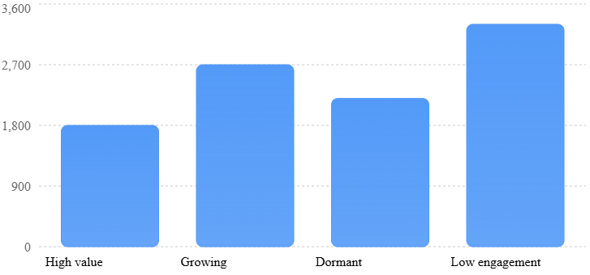
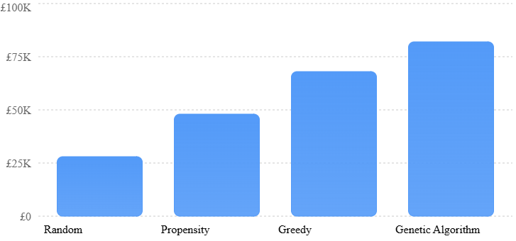

# Profit-Aware Campaign Optimizer: Implementation Plan

- **Project:** AI-powered, profit-aware customer growth and campaign optimization (retail term-deposit campaign)
- **Dataset:** UCI Bank Marketing (`bank-full.csv`, 45,211 records)
- **Stack:** Python 3.12, pandas, scikit-learn, SciPy, Plotly, Streamlit; project managed with **uv** (no deep learning, no RAG, no multi-agent architecture)

---

## 1. Objective

Build an end-to-end prototype that helps a bank decide **whom to contact** in a term-deposit campaign, and **through which channel**, so that a limited budget earns the most expected contribution while respecting responsible-customer rules.

| # | Business question | Answered by |
|---|---|---|
| Q1 | Which customers are most likely to subscribe? | Engine 1: propensity model (P_i) |
| Q2 | Which customers have the greatest potential financial value? | Engine 1 + 2: RFM value proxy and estimated contribution (V_i) |
| Q3 | How much should the bank spend to acquire each customer? | Engine 2: break-even cost (P_i x V_i) and expected profit (EP_i) |
| Q4 | Which combination of customers should be targeted? | Engine 3: genetic algorithm under constraints |
| Q5 | How much incremental profit compared with the existing strategy? | Strategy comparison: GA vs random, propensity-only and greedy (plus rule-based and the exact optimum) |

---

## 2. Confirmed design decisions

| Area | Decision |
|---|---|
| Propensity model | **Logistic Regression (primary)** drives the engines. **Random Forest (challenger)** is trained as a benchmark only. |
| Baselines for Q5 | Random targeting within budget (proxy for the historical campaign), propensity-only, greedy by expected profit and rule-based (highest balance first). The exact MILP optimum is the reference ceiling. |
| Channels | **Binary chromosome.** Channel is fixed per customer from the `contact` field. Each channel has its own fully-loaded cost and capacity. |
| Budget | **£50K** headline budget. With fully-loaded channel costs, the budget is a real, binding constraint. |
| Economics | Transparent default assumptions in one config file, all editable as Streamlit sliders. |
| Leakage | Exclude `duration`, `campaign`, `day` and `month` from the model. RFM Frequency = `previous`. A leakage ablation is reported. |
| Eligibility | Hard-exclude credit default, negative balance and contact fatigue. Flag and cap (not exclude) customers aged 75+. Add a reporting-only fairness monitor. |
| Segments | **High value, Growing, Dormant, Low engagement**, matching the Screen 1 reference. |
| Screen 3 chart | Four bars (Random, Propensity, Greedy, Genetic Algorithm) as in the reference. The MILP optimum is shown as a dashed line; rule-based and MILP results also appear in the table. |

### 2.1 Why Logistic Regression as the primary model

| | Logistic Regression | Random Forest |
|---|---|---|
| Probability calibration | Good out of the box. This matters because P_i is multiplied by money in EP_i. | Poor raw probabilities. Needs `CalibratedClassifierCV`. |
| Explainability | Coefficients and odds ratios are easy to explain to business and risk teams. | Feature importance only. Per-customer reasons need SHAP. |
| Non-linearity | Needs engineered bins (age bands, recency buckets). | Captures it natively. |
| Typical ROC-AUC on this task (no leakage) | ~0.75 - 0.78 | ~0.76 - 0.80 |
| Speed / simplicity | Very fast, few hyperparameters | Slower, more tuning |

**Recommendation:** use LR as the engine because its calibrated, explainable probabilities suit a money-weighted decision in a regulated setting. The RF challenger shows the size of the accuracy-vs-explainability trade-off. If RF is materially better (for example, more than 0.02 PR-AUC), the pipeline lets you switch it in through config.

**Important:** do **not** use `class_weight="balanced"`. It distorts the probabilities. Handle class imbalance through ranking metrics (PR-AUC, precision@K) instead.

### 2.2 Leakage policy

The model simulates the **morning before the campaign starts**. Only information that exists at that moment may be used.

| Column | Meaning | Pre-campaign? | Use |
|---|---|---|---|
| `duration` | Length of last call | No | Excluded |
| `campaign` | Contacts made in *this* campaign | No. Partly caused by the outcome (customers who say yes stop being called) | Excluded from model; EDA only |
| `day`, `month` | Date of last contact | No. Reflects the historical calling schedule, not the customer | Excluded from model; EDA only |
| `previous`, `pdays`, `poutcome` | Earlier-campaign history | Yes | Model features (RFM recency/frequency) |
| `age`, `job`, `marital`, `education`, `default`, `balance`, `housing`, `loan`, `contact` | Customer profile | Yes | Model features |

A **leakage ablation** (Milestone 6) reports the model's AUC with and without the excluded columns. This makes the integrity trade-off visible.

### 2.3 Responsible-customer eligibility rules

These are applied **before** optimization. Ineligible customers never enter the GA chromosome.

| Rule | Treatment | Approx. share | Rationale |
|---|---|---|---|
| `default = yes` | Hard exclude | ~2% | Clear financial stress |
| `balance < 0` | Hard exclude | ~8% | Overdrawn customers should not be pushed to lock money away |
| `previous > 10` | Hard exclude | <1% | Contact fatigue |
| `age >= 75` | Flag + segment cap (default at most 2% of selected list), shown for human review | <1% | Age is a protected characteristic, so a blanket exclusion would itself be unfair. Extra care is applied instead. |

**Fairness monitor (reporting only):** compares the targeting rate by age band and job group against the eligible base and highlights large skews. All thresholds are configurable.

---

## 3. Solution architecture

```
                 bank-full.csv (UCI)
                        |
          [Milestone 1] data.py / features.py
          clean -> RFM-inspired features -> eligibility flags -> train/test split
                        |
 ENGINE 1  Customer Intelligence       (model.py, segmentation.py)
          LR propensity P_i (+ RF challenger), RFM scores, engagement score, segments
          Output: customer_id, P_i, segment, value proxy
                        |
 ENGINE 2  Profit Intelligence         (economics.py)
          V_i = funding-spread contribution - incentive - onboarding
          EP_i = P_i x V_i - C_i
          Output: expected incremental contribution per customer
                        |
 ENGINE 3  Optimization Intelligence   (optimize.py)
          Genetic algorithm (+ random, propensity, greedy, rule-based baselines, MILP optimum)
          Constraints: budget, max contacts, channel capacity, eligibility, segment limits
          Output: optimized target list + campaign profitability
                        |
          Streamlit dashboard (app/)  <->  Jupyter notebooks (notebooks/)
```

### 3.1 Repository layout

```
profit-aware-campaign-optimizer/
|-- plans/                      # this plan (.md + .pdf) and references/ (dashboard reference images)
|-- data/
|   |-- raw/                    # downloaded UCI files (bank-full.csv)
|   `-- processed/              # cleaned features, scored universe
|-- artifacts/                  # trained model (.joblib), metrics (.json), GA results
|-- src/pacopt/
|   |-- config.py               # ALL assumptions: economics, channels, eligibility, GA params
|   |-- data.py                 # download, load, clean
|   |-- features.py             # RFM-inspired features, eligibility flags, leakage guard
|   |-- model.py                # LR + RF pipelines, calibration, evaluation metrics
|   |-- segmentation.py         # RFM scores, engagement score, segment labels
|   |-- economics.py            # deposit size, V_i, C_i, EP_i, break-even cost
|   |-- optimize.py             # GA, baselines, constraint checker, MILP optimum
|   |-- evaluation.py           # strategy comparison, backtest, fairness monitor
|   |-- charts.py               # shared Plotly chart styles (reference look)
|   `-- pipeline.py             # one command: data -> model -> EP -> optimize -> artifacts
|-- notebooks/                  # 01_data_preparation ... 05_validation (import src/pacopt)
|-- app/
|   |-- Home.py                 # Revenue AI Command Centre
|   `-- views/                  # 1_Customer_Intelligence, 2_Propensity_and_Opportunities,
|                               # 3_Campaign_Optimization, 4_What_If_Simulation
|-- tests/                      # pytest unit + integration tests
|-- docs/DECISIONS.md          # decision log: every key architecture/design/code decision (section 8)
|-- scripts/build_plan_pdf.py   # regenerates the PDF of this plan
|-- pyproject.toml              # project metadata, dependencies, dependency groups, tool config
|-- uv.lock                     # exact, cross-platform lockfile (committed)
|-- .python-version             # 3.12
`-- README.md
```

The notebooks import from `src/pacopt`, and so does Streamlit. Logic is written once and reused by both. `pacopt` is installed in editable mode by `uv sync`, so `import pacopt` works everywhere without any `sys.path` hacks.

### 3.2 Project management with uv

| Item | Setup |
|---|---|
| Python | `.python-version` = 3.12; `requires-python = ">=3.12"`. uv downloads 3.12 if a teammate doesn't have it. |
| Package | `uv init --lib --name pacopt`: src layout with a build backend, so `pacopt` installs as an editable package |
| Runtime dependencies | `uv add pandas numpy scikit-learn scipy streamlit plotly joblib` |
| Dev group | `uv add --dev pytest ipykernel jupyterlab` |
| Docs group | `uv add --group docs markdown` (PDF build of this plan) |
| Lockfile | `uv.lock` is committed; `.venv/` is git-ignored |

**Everyday commands**

```
uv sync                                         # create/refresh .venv from uv.lock (teammate setup)
uv run python -m pacopt.pipeline                # data -> model -> EP -> optimize -> artifacts
uv run streamlit run app/Home.py                # dashboard
uv run pytest                                   # tests
uv run jupyter lab                              # notebooks (kernel = project .venv)
uv run --group docs python scripts/build_plan_pdf.py   # rebuild the plan PDF
```

---

## 4. Milestones

A milestone is **complete only when every sub-task is done and its acceptance criteria pass.** For every milestone, the acceptance criteria also include: **every key decision taken during the milestone is recorded in `docs/DECISIONS.md`** (section 8).

### Milestone 1: Data preparation

- [ ] 1.1 Set up the environment with uv: add the runtime and dev dependencies (section 3.2), run `uv sync`, commit `pyproject.toml` and `uv.lock`, and create the `src/pacopt` module skeleton.
- [ ] 1.2 Download the UCI zip (`https://archive.ics.uci.edu/static/public/222/bank+marketing.zip`). Extract the nested `bank.zip`, store `bank-full.csv` under `data/raw/` and record its source and licence (CC BY 4.0) in `data/raw/README.md`.
- [ ] 1.3 Load into pandas (`sep=";"`) and validate the schema: 45,211 rows, 17 columns, ~11.7% positive rate.
- [ ] 1.4 Clean the categorical features. Strip and lower-case values, keep `"unknown"` as its own category, and map the binary fields (`default`, `housing`, `loan`, `y`) to 0/1.
- [ ] 1.5 Create the RFM-inspired features:
  - **Recency:** `never_contacted = (pdays == -1)`, `recency_days` (NaN when never contacted), recency bucket (`never`, `<=90d`, `91-180d`, `181-365d`, `>365d`).
  - **Frequency:** `frequency = previous`, `prior_success = (poutcome == "success")`.
  - **Monetary proxy:** `balance` (a value indicator, **not revenue**), signed-log balance and balance quintile.
  - **Profile:** age band (`18-29`, `30-44`, `45-59`, `60-74`, `75+`).
- [ ] 1.6 Create eligibility flags (`elig_default`, `elig_negative_balance`, `elig_fatigue`, `flag_age_75plus`) and a combined `eligible` column.
- [ ] 1.7 Add a **leakage guard**: `features.MODEL_FEATURES` is an explicit allow-list, and a check raises an error if `duration`, `campaign`, `day`, `month` or `y` appear in it.
- [ ] 1.8 Stratified split: 70% train and 30% test (`random_state=42`). From the test set, draw the **campaign universe of 10,000 customers**. These customers are scored out-of-sample.
- [ ] 1.9 Assign stable customer IDs (`C100001` and so on).
- [ ] 1.10 Notebook `01_data_preparation.ipynb`: EDA covering the target rate, conversion by `poutcome`, the balance distribution and the eligibility counts.

**Acceptance criteria:** the raw file is in the repo; no unexpected nulls; train and test positive rates are within 0.5 pp of each other; the universe has exactly 10,000 rows; the leakage guard test passes.

### Milestone 2: ML propensity model

- [ ] 2.1 LR pipeline: `ColumnTransformer` (`OneHotEncoder(handle_unknown="ignore")` + `StandardScaler`) feeding `LogisticRegression`. Tune `C` with 5-fold stratified CV, optimising average precision.
- [ ] 2.2 RF challenger: `RandomForestClassifier` (about 300 trees, `min_samples_leaf` around 50) wrapped in `CalibratedClassifierCV(method="isotonic")`.
- [ ] 2.3 Predict subscription probability on the held-out test set.
- [ ] 2.4 Evaluate: ROC-AUC, PR-AUC, **precision@K** (K = 500, 1,000, 2,000 and the budget-implied contact count), Brier score, calibration curve, decile lift/gains table.
- [ ] 2.5 Explainability: LR coefficients and odds ratios, RF permutation importance.
- [ ] 2.6 Model-choice summary (LR vs RF), with the final selection recorded in `config.py`.
- [ ] 2.7 Generate P_i for the 10,000-customer universe and save `artifacts/model.joblib` and `artifacts/metrics.json`.
- [ ] 2.8 Notebook `02_propensity_model.ipynb`.

**Acceptance criteria:** LR test ROC-AUC is at least 0.72; predicted and actual rates agree within 1.5 pp in each calibration decile; precision@1,000 is clearly above the 11.7% base rate (target 2-3x lift); results are reproducible with a fixed seed.

### Milestone 3: Revenue calculation and segmentation

**3.1 Product economics (term deposit = funding product)**

The deposit principal is **never counted as revenue**. The bank earns the funding benefit: the transfer-pricing (FTP) rate credited to the deposit, minus the interest paid to the customer.

```
Deposit amount      D_i  = clip(D_min + alpha x max(balance_i, 0), D_min, D_max)
Funding spread      s    = FTP_rate - customer_rate
Contribution value  V_i  = D_i x s x term_years  -  incentive  -  onboarding_cost
Contact cost        C_i  = channel_cost[channel_i]            (fully loaded)
Expected profit     EP_i = (P_i - P0_i) x V_i  -  C_i
Break-even cost     BE_i = (P_i - P0_i) x V_i      (most the bank should spend to contact i)
```

| Parameter | Starting default (editable) | Note |
|---|---|---|
| `D_min` | £10,000 | Minimum term-deposit ticket (assumes some new money) |
| `alpha` | 1.0 | Multiple of the average balance placed in the deposit |
| `D_max` | £100,000 | Cap |
| `FTP_rate` / `customer_rate` | 4.75% / 3.00% | 1.75% funding spread |
| `term_years` | 1 | 12-month product |
| `incentive` / `onboarding_cost` | £40 / £5 | Paid only on conversion |
| `P0_i` (organic rate) | 0 | There is no control group in the data, so this is configurable |
| **Campaign budget** | **£50,000** | Headline scenario |
| Channel cost: outbound mobile call (`cellular`) | £12 | Fully loaded: agent time, telephony, compliance QA |
| Channel cost: landline call (`telephone`) | £10 | Fully loaded |
| Channel cost: digital (`unknown` contact) | £2 | Email / app / SMS |

- The defaults are **illustrative starting assumptions**, not bank figures. Sub-task 3.3 calibrates them so that (a) a meaningful share (roughly 25-50%) of eligible customers has positive EP, and (b) the **£50K budget binds**: the cost of all positive-EP customers, after the channel caps, exceeds £50K.
- The dataset's balances are in euros (Portuguese bank). They are shown as £ for illustration only.

**3.2 Segmentation (Engine 1 output, matches the Screen 1 reference)**

Every customer in the universe gets exactly one of four segments from a transparent propensity-by-value grid. The thresholds are in config: propensity is "high" in the top 40% of P_i, and value is "high" at or above the median of V_i.

| Segment | Rule | Business meaning |
|---|---|---|
| **High value** | High P_i and high V_i | Priority targets |
| **Growing** | High P_i and lower V_i | Likely to convert; build the relationship |
| **Dormant** | Low P_i and high V_i | Valuable balances but disengaged (often never or long-ago contacted); reactivation candidates |
| **Low engagement** | Low P_i and low V_i | Deprioritise |

Separately from the segments: RFM scores 1-5 (R from `pdays`, F from `previous`, M from balance quintile), an engagement score (weighted R, F and prior success) and the eligibility/protected flags. These are shown as overlays, not as segments.

**Sub-tasks**

- [ ] 3.3 Implement `economics.py` (all parameters from `config.py`) and calibrate the defaults against the two targets above.
- [ ] 3.4 Calculate D_i, V_i, C_i, EP_i and BE_i for the universe.
- [ ] 3.5 Rank customers by EP_i and by EP_i / C_i (return per £).
- [ ] 3.6 Implement `segmentation.py`: the four segments, RFM scores and engagement score.
- [ ] 3.7 Identify high-value opportunities: the top EP decile and its share of the total positive EP.
- [ ] 3.8 Sensitivity table: total positive EP under ±50% changes to the spread, incentive and contact cost.
- [ ] 3.9 Notebook `03_profit_engine.ipynb`.

**Acceptance criteria:** unit tests verify EP on hand-calculated examples; no principal appears in revenue; every customer has an EP and exactly one segment; the four segment counts sum to 10,000; the budget binds in the default scenario.

### Milestone 4: Genetic algorithm (Engine 3)

**Problem formulation:** maximise `sum_i x_i x EP_i`, with `x_i` in {0, 1}, over eligible customers, subject to:

| Constraint | Form | Default |
|---|---|---|
| Campaign budget | `sum x_i C_i <= B` | £50,000 |
| Maximum contacts | `sum x_i <= N_max` | 6,000 |
| Channel capacity | `sum over channel x_i <= cap_ch` | Calls (mobile + landline) 4,500; digital 2,500 |
| Eligibility | ineligible customers are not in the chromosome | section 2.3 |
| Segment limits | `min_s <= share in segment s <= max_s` | Any segment at most 60%; Growing at least 15%; Dormant at least 10% (reactivation); Protected 75+ at most 2% |

**GA design**

| Component | Choice |
|---|---|
| Chromosome | Binary NumPy vector, one gene per eligible customer. The population is a (pop x n) matrix, so operations are vectorised. |
| Initialisation | Random sparse chromosomes (density matched to the budget) plus a few seeded with greedy solutions. Results are reported with and without greedy seeding. |
| Fitness | Total EP of a feasible chromosome. A **repair operator** drops the lowest EP/C selections until the budget, contact and channel limits hold, then rebalances the segments. A soft penalty is the fallback for the segment minimums. |
| Selection / crossover / mutation | Tournament (k = 3) / uniform (p = 0.9) / asymmetric bit-flip (separate add and drop rates) |
| Elitism / stopping | Top 2% carried over / 300 generations or 50 generations without improvement |
| Defaults | Population 100, fixed `random_state` |

**Strategies compared (Q5)**

| Strategy | Definition | Where shown |
|---|---|---|
| **Random** | Random eligible customers until the budget is used, averaged over 50 seeds. Proxy for the historical untargeted campaign. | Chart + table |
| **Propensity** | Highest P_i first, subject to the constraints | Chart + table |
| **Greedy** | Highest EP_i / C_i first, skipping any customer who would break a constraint | Chart + table |
| **Genetic Algorithm** | Section above | Chart + table |
| Rule-based | Highest balance first (a typical business rule) | Table |
| MILP optimum | `scipy.optimize.milp` exact optimum under the same constraints | Table + dashed "theoretical max" line on the chart |

Honest framing: under a budget-only constraint, greedy is near-optimal (a knapsack problem). The GA adds value under the **interacting** constraints in the default scenario (channel capacities plus segment minimums and maximums). Results report "GA reaches X% of the optimum".

**Sub-tasks**

- [ ] 4.1 Create the binary customer-selection chromosome.
- [ ] 4.2 Define the fitness function.
- [ ] 4.3 Add the budget, contact, channel and segment constraints, with a shared `check_constraints()` used by every strategy.
- [ ] 4.4 Implement selection, crossover, mutation, elitism and repair.
- [ ] 4.5 Implement the baselines (random, propensity, greedy, rule-based) and the MILP optimum.
- [ ] 4.6 Convergence plot (best and mean fitness per generation).
- [ ] 4.7 Strategy comparison table: contacts, spend, expected conversions, expected contribution, ROI, % of optimum, constraint compliance.
- [ ] 4.8 Notebook `04_genetic_algorithm.ipynb`.

**Acceptance criteria:** every strategy passes `check_constraints()`; the GA beats random and propensity; the GA is at least as good as greedy under the full constraint set; the GA reaches at least 98% of the MILP optimum; the default GA run takes under 60 seconds.

### Milestone 5: Streamlit dashboard

**Global sidebar:** economic assumptions, budget, channel costs and capacities, eligibility toggles and the model choice. Results are cached with `st.cache_data` / `st.cache_resource`.

**Chart style (from the reference images), implemented once in `charts.py`:** vertical bars in a single blue (about `#4F97FB`, with a light top-to-bottom shade), rounded bar corners (Plotly `marker.cornerradius`), dashed light-grey horizontal gridlines, no legend, plain category labels under each bar, a white background, and an auto-scaled y-axis (counts, or £K with a `£` prefix). Each chart has a caption stating that it shows prototype results based on stated assumptions.

#### Home: Revenue AI Command Centre

Four KPI tiles: **Customers analysed** (10,000) · **Average conversion propensity** (mean P_i of the selected list) · **Campaign budget** (£50K) · **Expected contribution** (GA result), with incremental contribution vs Random shown underneath.

#### Screen 1: Customer Intelligence

Reference layout:



*Reference figures are illustrative. The dashboard shows the actual segment counts from the pipeline.*

- **Headline chart:** number of customers per segment (High value, Growing, Dormant, Low engagement), in the reference style.
- Below it: a segment profile table (count, average age, average balance, average P_i, average V_i, % eligible), a value-by-propensity scatter showing the four quadrants, and an eligibility breakdown.

#### Screen 2: Propensity and Revenue Opportunities

- A searchable, sortable customer table with columns **Customer | Propensity | Segment**, as in the brief (e.g. `C100123 | 91% | High value`), expandable to channel, V_i, EP_i and break-even cost.
- Top-N opportunities, a model performance panel (ROC/PR curves, calibration, precision@K, top drivers) and CSV export.

#### Screen 3: Campaign Optimization

Reference layout:



*Reference figures are illustrative. The dashboard shows the actual strategy results.*

- **Headline chart:** expected contribution (£) for **Random, Propensity, Greedy, Genetic Algorithm**, in the reference style, plus a dashed horizontal line for the MILP optimum.
- Below it: a "Run GA" button, the full comparison table (adds Rule-based and the MILP optimum), the convergence chart, the channel and segment mix of the selected list, a constraint-compliance checklist, the fairness monitor and a downloadable target list.

#### Screen 4: What-if Simulation

- Inputs: marketing budget (default £50K), contact cost per channel, spread and incentive.
- Shows the **maximum affordable contacts (budget-only upper bound) = budget / cost** next to the **actual allocation** after the eligibility and campaign constraints.
- A profit-vs-budget curve (greedy over a budget grid, marking the point where the marginal EP of the next contact reaches zero) and an on-demand GA re-run.

**Sub-tasks**

- [ ] 5.1 App skeleton, sidebar, caching and `charts.py` (reference style).
- [ ] 5.2 Home page.
- [ ] 5.3 Screen 1.
- [ ] 5.4 Screen 2.
- [ ] 5.5 Screen 3.
- [ ] 5.6 Screen 4.
- [ ] 5.7 Disclaimers on every screen: illustrative assumptions, not bank performance.

**Acceptance criteria:** `uv run streamlit run app/Home.py` launches with no errors; the Screen 1 and Screen 3 charts visually match the reference style; every figure comes from pipeline outputs (no hard-coded numbers); slider changes update the results; a GA re-run finishes within the stated time.

### Milestone 6: Validation and presentation

- [ ] 6.1 **End-to-end test:** from a clean clone, `uv sync` followed by `uv run python -m pacopt.pipeline` runs from the raw CSV to the artifacts. An integration test asserts the output shapes and that the outputs are feasible.
- [ ] 6.2 **Leakage checks:** a forbidden-column unit test; an ablation table (only `duration` removed / `duration`, `campaign`, `day` and `month` removed (the chosen model) / everything included); confirmation that all fitted transforms sit inside the sklearn `Pipeline`, after the split.
- [ ] 6.3 **Optimization constraint checks:** property tests on random scenarios confirming that every strategy respects the budget, contact, channel, eligibility and segment limits, and that repair always returns a feasible solution.
- [ ] 6.4 **Backtest:** realised conversions and contribution of each strategy's list, using the actual `y` in the test universe, compared with the expected values.
- [ ] 6.5 **Robustness:** GA results across 5 seeds (mean ± std); sensitivity of the strategy ranking to the economic assumptions.
- [ ] 6.6 **Fairness monitor review:** targeting rate by age band and job, documented.
- [ ] 6.7 **Presentation pack:** README (setup, run, architecture), assumptions and limitations, a dashboard demo script, and answers to Q1-Q5 with numbers.

**Acceptance criteria:** `uv run pytest` passes; the ablation table and backtest are produced; a teammate can reproduce the results from a clean clone using only `uv sync` and the README commands.

---

## 5. How each business question is answered in the final demo

| Question | Evidence shown |
|---|---|
| Q1 Likely subscribers | Screen 2 propensity ranking, lift/gains chart, precision@K |
| Q2 Greatest value | Screen 1 segment chart and value-by-propensity map; Screen 2 V_i / EP_i ranking; top EP decile |
| Q3 Spend per customer | Break-even cost BE_i per customer; Screen 4 marginal-return curve |
| Q4 Best combination | Screen 3 GA target list with channel and segment mix and constraint checklist |
| Q5 Incremental profit | Screen 3 strategy chart (GA vs Random, Propensity, Greedy, against the optimum line); backtest on actual outcomes |

---

## 6. Assumptions and limitations

1. **Not true RFM:** the dataset has no transactions, searches or browsing. The features are RFM-*inspired*.
2. **Balance is not revenue or CLV.** It is used only as a value indicator to estimate deposit size.
3. **Economics are illustrative.** FTP spread, deposit size, incentives and fully-loaded costs are assumptions, editable in the app.
4. **"Incremental" means relative to a baseline strategy, not causal uplift.** P_i is P(subscribe | contacted). There is no control group.
5. **Historical context.** The data comes from a 2008-2010 Portuguese campaign. Results show the method, not current bank performance.
6. **Channel effects.** The channel is fixed by the `contact` field, and its effect on response is learned only through that feature.

---

## 7. Risks and mitigations

| Risk | Mitigation |
|---|---|
| Few customers have positive EP, or the budget doesn't bind, under the defaults | Calibration sub-task 3.3 with explicit targets; the sensitivity table shows the dependence |
| GA no better than greedy | Interacting constraints in the default scenario; honest reporting against the MILP optimum |
| GA too slow in Streamlit | Vectorised population, chromosome limited to eligible customers with positive EP, caching, on-demand runs |
| Environment drift across the team | uv pins Python 3.12 (`.python-version`) and exact versions (`uv.lock`); everyone runs `uv sync` |
| Over-claiming results | Disclaimers on every screen and chart; assumptions section in the README |
| Rationale lost between sessions or team members | `docs/DECISIONS.md` updated as each decision is made; a milestone isn't complete without it |

---

## 8. Decision log (`docs/DECISIONS.md`)

Every key architectural, design or code decision is recorded **when it is made**, not afterwards. This covers planning, implementation and any later changes. If a decision is reversed, the old entry is kept and marked `Superseded by D-0xx`, and a new entry explains the change.

**What counts as a key decision:** anything a teammate might ask "why did we do it this way?" about. Examples: a modelling or feature choice, a formula or default assumption, an algorithm or operator choice, a constraint definition, a library or tool, a data split, a UI or chart choice, or a trade-off between accuracy, speed and simplicity. Small implementation details (variable names, formatting) are not recorded.

**Entry template**

```
## D-0xx: <short title>
- Date: YYYY-MM-DD | Milestone: Mx | Status: Accepted / Superseded by D-0yy
- Context: the problem or question that forced a decision
- Decision: what we chose
- Why: the reasons this option won
- Alternatives considered (and why not taken):
  - <option A>: <reason rejected>
  - <option B>: <reason rejected>
- Other possible alternatives (not evaluated / future options):
  - <option>: <when it might be worth switching>
- Consequences: what this commits us to, risks, follow-ups
- Related: D-0xx, files/modules affected
```

**Initial entries (decisions made during planning)**

| ID | Decision | Main alternatives recorded |
|---|---|---|
| D-001 | Python + pandas + scikit-learn + Streamlit; no deep learning, RAG or agents | Deep-learning model, LLM/RAG layer, Dash/React front end |
| D-002 | uv for project management (pyproject + uv.lock, Python 3.12) | pip + requirements.txt, Poetry, conda |
| D-003 | UCI Bank Marketing `bank-full.csv` as the data source | Synthetic data, `bank-additional-full.csv` (with macro indicators), other public datasets |
| D-004 | Leakage policy: exclude `duration`, `campaign`, `day`, `month` | Drop only `duration`; keep `campaign` with an ablation |
| D-005 | RFM-inspired features: Frequency = `previous`; balance used only as a value proxy | Frequency = `previous + campaign`; balance treated as revenue/CLV |
| D-006 | Logistic Regression primary, calibrated Random Forest as challenger | RF only, LR only, gradient boosting (HistGradientBoosting/XGBoost) |
| D-007 | Eligibility: hard-exclude default, negative balance and fatigue; flag and cap 75+; fairness monitor | Hard-exclude 75+; no eligibility rules; fairness as a hard constraint |
| D-008 | Term deposit valued as a funding product (FTP spread minus incentive and onboarding); principal never counted as revenue | Count deposit principal; flat value per conversion; NIM-based CLV model |
| D-009 | £50K budget with fully-loaded channel costs (£12 / £10 / £2) | £5 per contact with capacity caps binding; £20K budget |
| D-010 | Binary chromosome with the channel fixed from the `contact` field | Integer chromosome where the GA picks the channel; single channel |
| D-011 | Constraint handling with a repair operator plus a soft penalty for segment minimums | Death penalty, pure penalty function, constraint-preserving operators only |
| D-012 | Strategy set: Random, Propensity, Greedy, GA + Rule-based + MILP optimum | Random only; compare against a blanket "contact all eligible" |
| D-013 | Four segments (High value, Growing, Dormant, Low engagement) from a propensity-by-value grid | k-means clustering; classic 11-segment RFM taxonomy |
| D-014 | Campaign universe = 10,000 customers sampled from the held-out test set (out-of-sample scores) | Score all 45,211; cross-validated out-of-fold scores |
| D-015 | "Incremental" = relative to the baseline strategies, with organic rate P0 = 0 (configurable) | Uplift / two-model approach (needs a control group the data lacks) |
| D-016 | Modular `src/pacopt` package shared by notebooks and Streamlit | Logic inside notebooks; logic inside Streamlit pages |
| D-017 | Screen 1 / 3 charts follow the reference style (single-blue rounded bars); Screen 3 shows 4 bars + a dashed MILP line | Show all 6 strategies as bars; grouped/stacked charts |
| D-018 | Plotly for dashboard charts | Altair, matplotlib, Streamlit native charts |
| D-019 | Plan PDF built from Markdown via headless Edge | pandoc + LaTeX, reportlab/fpdf, Word export |
